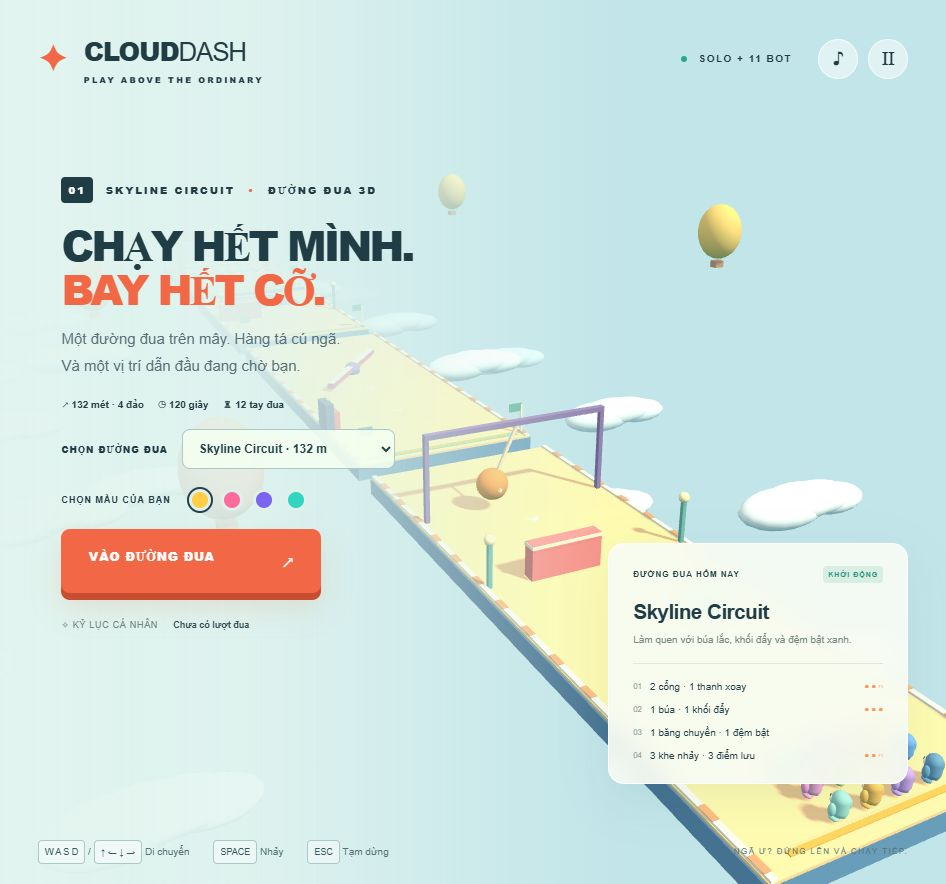

# Cloud Dash — AI-Assisted Development Report

**English** | [Tiếng Việt](REPORT.vi.md)

[← Back to the main README](README.md)

**Report date:** October 14, 2026. All times use Vietnam time, UTC+7 (Asia/Saigon).

**Scope:** user requests, implementation iterations in this conversation, deliverables, testing, timing, and verifiable cost information. This is a project report, not an invoice or performance benchmark.

## 1. Objective and outcome

The user requested a complete interactive product with a finished interface, animation, controls, collision handling, and immediately runnable source code. The initial prompt allowed either a Fall Guys-style 3D game or an interactive financial dashboard. The implemented option was **Cloud Dash**, an original 3D obstacle racer played solo against 11 bots.

After two gameplay expansions, the game includes three courses spanning 132–480 meters and six mechanics: sliding gates, rotating bars, swinging hammers, lateral pushers, conveyors, and jump pads. Players can choose a course and character color, pause, restart, return to the lobby, and save separate course records.

## 2. User prompts and implementation

The prompts below are **English translations of the user's Vietnamese requests**, in chronological order. The [Vietnamese report](REPORT.vi.md) preserves the original wording. Exact message timestamps were not available in the data used for this report.

### Prompt — Build the initial product

```text
Build a complete [Fall Guys-style 3D game / or an interactive financial dashboard] using plain HTML/TailwindCSS/JS (or Three.js running smoothly at 60fps).
Mandatory requirements:
- A complete, intuitive user interface, with no placeholders.
- Built-in control logic, animation effects, and collision handling.
- Export all source code as immediately runnable files, with one-step setup instructions.
```

**Implementation:** selected the game option using HTML, plain CSS, JavaScript, and Three.js. Built the lobby, course, characters, bots, physics, and results screen. Bundled Three.js and its license in `vendor` for offline operation. A financial dashboard was not implemented.

### Documentation language update

The subsequent request was to make English the primary version while keeping Vietnamese available through links. `README.md` and `REPORT.md` are now English; `README.vi.md` and `REPORT.vi.md` retain Vietnamese content. Each document links to its counterpart. This documentation update does not change the Vietnamese game interface.

## 3. Delivered product

### Interface and game flow

- Vietnamese lobby with course information, character colors, and a start button.
- Starting countdown and HUD showing rank, island, progress, and remaining time.
- WASD/arrow-key movement, Space to jump, Esc to pause, and touch controls.
- Following camera, limb animation, and collision reactions.
- Checkpoint respawning, results screen, restart, and return to lobby.
- Toggleable synthesized audio; automatic pause on focus loss or tab switching.
- Personal bests in localStorage when permitted, without accounts or cloud synchronization.

### Current course configuration

| Course            | Length |       Limit | Islands / gaps | Gates | Rotating bars | Hammers | Pushers | Conveyors | Jump pads |
| ----------------- | -----: | ----------: | -------------- | ----: | ------------: | ------: | ------: | --------: | --------: |
| Skyline Circuit   |  132 m | 120 seconds | 4 / 3          |     2 |             1 |       1 |       1 |         1 |         1 |
| Sunset Marathon   |  300 m | 210 seconds | 6 / 5          |     2 |             2 |       3 |       3 |         2 |         2 |
| Aurora Expedition |  480 m | 300 seconds | 10 / 9         |     1 |             5 |       5 |       5 |         4 |         3 |

These figures describe the current source configuration. Each gap has a checkpoint on the following island.

### Mechanics

| Mechanic        | Behavior                               | How to pass                            |
| --------------- | -------------------------------------- | -------------------------------------- |
| Sliding gate    | Moves sideways and blocks racers       | Change lanes and time the opening      |
| Rotating bar    | Sweeps low and knocks racers away      | Jump or time the rotation              |
| Swinging hammer | Orange head knocks the character away  | Dodge sideways or wait for the upswing |
| Pusher          | Extends from the course edge           | Avoid its side or jump over it         |
| Conveyor        | Moves grounded racers forward/backward | Adjust movement or jump off            |
| Jump pad        | Launches a grounded character upward   | Steer while airborne                   |

## 4. Technology and source structure

| File                         | Purpose                                                              |
| ---------------------------- | -------------------------------------------------------------------- |
| `index.html`                 | Interface structure, course selector, HUD, and dialogs               |
| `style.css`                  | Responsive layout and styling in plain CSS                           |
| `game.js`                    | Three.js scene, courses, characters, bots, physics, loop, and states |
| `obstacles.js`               | Placement, geometry, animation, collision, and AI assistance         |
| `verify.cjs`                 | Headless logic checks using Node.js and bundled Three.js             |
| `vendor/three.min.js`        | Local Three.js r160, without a CDN dependency during play            |
| `vendor/LICENSE.txt`         | Three.js MIT license                                                 |
| `preview.png`                | Screenshot from the latest gameplay update                           |
| `README.md` / `README.vi.md` | English / Vietnamese instructions                                    |
| `REPORT.md` / `REPORT.vi.md` | English / Vietnamese reports                                         |

Physics uses a fixed 1/120-second step. Rendering uses requestAnimationFrame, with pixel ratio capped at 1.6. Graphics use geometry and colors generated in code, without Fall Guys images or models. Playing requires no backend, database, npm, or build step. Node.js is only needed for checks; Python is optional for a development HTTP server.

## 5. Development timeline

### Evidence-backed milestones

| October 14, 2026, UTC+7 | Work / evidence                                                                          |
| ----------------------- | ---------------------------------------------------------------------------------------- |
| 23:01:19                | `index.html` creation time from file metadata                                            |
| 23:03:58                | `game.js` creation time from file metadata                                               |
| Around 23:06            | Initial checks and packaging; tool logs recorded ZIP creation                            |
| Around 23:12            | Browser inspection of course selection and Aurora; HTTP log recorded loading at 23:12:52 |
| 23:17:07–23:17:16       | Created `obstacles.js` and updated game/check files                                      |
| Around 23:18            | Inspected the interface with new mechanics; completed logic checks                       |
| 23:19:03                | Gameplay ZIP timestamp before adding the report, read from file metadata                 |
| Around 23:22 onward     | Began preparing the report requested in prompt 4                                         |

**Observed elapsed time from HTML creation to the latest gameplay package: 17 minutes 44 seconds** (23:01:19 → 23:19:03).

This is wall-clock time, potentially including tools, testing, waiting, and exchanges between requests. It is **not** active labor time, model reasoning time, or the entire interval since the initial prompt. Investigation before HTML creation is excluded. Report writing and the language update are also outside this interval.

There is insufficient data to allocate exact time to each prompt or feature. Approximate milestones come from conversation logs; file metadata can change during copying, extraction, or rewriting. The ZIP timestamp is a historical snapshot before documentation packaging, not a statement about the current archive's timestamp.

## 6. Costs and data limitations

### What can be confirmed

| Item                                       | Status in this project                                                               |
| ------------------------------------------ | ------------------------------------------------------------------------------------ |
| Three.js                                   | Bundled MIT version; no library purchase transaction                                 |
| Commercial images, models, audio           | None purchased; visuals generated in code and audio synthesized                      |
| Hosting, domain, backend                   | None deployed or purchased; the product runs locally                                 |
| APIs called during play                    | No paid API integration; game runs offline                                           |
| Codex/AI for code and documentation        | No invoice, subscription allocation, token counts, or actual session rates available |
| Computer, electricity, Internet, user time | Not measured or converted into monetary costs                                        |

**Total development cost in VND or USD cannot be determined from the available data.** The absence of hosting or asset purchases does not mean the entire project was free. AI subscription or usage charges may belong to the user's account, but the conversation does not establish their allocation to this project.

The assistant performed no purchase or paid-service ordering actions while building the game. This describes the actions taken; it does not establish that the AI system or tools have no account-level charges.

### Adding actual costs later

For API billing, obtain uncached input tokens, cached input tokens, output tokens, applicable rates, and tool fees from usage reports or invoices. If rates are per million tokens:

```text
AI cost = (uncached input tokens × input rate
         + cached input tokens × cache rate
         + output tokens × output rate) / 1,000,000
         + actual tool fees
```

For subscriptions, choose and document an allocation method rather than treating the subscription as an API invoice. Actual asset, hosting, and labor costs can be added if applicable. This report does not assume rates, research market prices, or substitute account quota percentages for monetary costs.

## 7. Testing and evidence

### Automated checks

Run from the game directory:

```bash
node verify.cjs
```

The suite uses real Three.js geometry and math, but replaces the renderer and DOM with test doubles. Results validate logic, not GPU quality, FPS, or interaction across all browsers.

Checks passed during the latest gameplay update:

- Race start, countdown, pause, and resume.
- Movement directions relative to the camera.
- Jumps across every gap on all three courses.
- Respawn, finish, and timeout using each course's limit.
- Rebuilding a course does not increase its scene-object count.
- Bots can complete all three courses; coordinates remain finite.
- Jump-pad launch velocity, hammer knockback, and pusher overlap resolution.
- Conveyors move grounded racers but do not move airborne racers.

Last run output before report preparation:

```text
PASS map: Skyline Circuit length: 132 AI finishers: 6
PASS map: Sunset Marathon length: 300 AI finishers: 6
PASS map: Aurora Expedition length: 480 AI finishers: 6
PASS: new obstacle collision, boost and conveyor behavior
PASS: race start, pause/resume, controls, gap jump, respawn, finish, timeout, AI simulation.
```

Six is the number of bots finishing within those simulation windows, not a guarantee that every bot finishes every race. `node --check` syntax validation also completed for modified gameplay files.

### Browser inspection

The preview was opened to inspect the 3D scene and layout, exercise start/pause, switch to Aurora, and confirm a HUD showing 10 islands and 05:00. After adding the mechanics, the lobby was inspected and a screenshot captured with the hammer visible.

Localhost access was initially restricted. After starting the preview server with appropriate permissions, the browser loaded successfully. Servers were stopped after inspection; the offline game does not depend on them.

## 8. Unverified results and unimplemented features

- **60fps has not been measured:** it remains a target from the prompt, without a benchmark confirming it on a specific configuration.
- Not every mobile device, viewport, or browser has been tested. Responsive styling and touch controls exist, but comprehensive compatibility is unverified.
- Collision uses simplified gameplay models, not physically exact simulation of every visible detail.
- No multi-hour endurance testing or difficulty balancing with a broad group of players.
- No network multiplayer, accounts, online leaderboard, or cloud saves.
- Token counts, AI invoices, total project cost, and active labor time remain unavailable.

## 9. Receiving and running the product

Extract the source ZIP if applicable, then **double-click `index.html`** in a WebGL-capable browser. No dependency installation is needed. See the [main README](README.md) for instructions, or the [Vietnamese README](README.vi.md).


